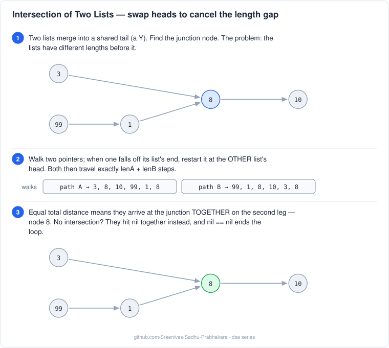

# Intersection Point of Two Linked Lists

> Striver SDE Sheet 031 · Day 6 Linked List — two pointers that swap onto the other list at the end, cancelling the length difference. Go, stdlib only, tested.

## Problem

Two singly linked lists merge into a shared tail (a "Y" shape). Find the first node common to both — compared by node identity, not by value — in O(1) space.

## Approach

The obstacle is that the lists have different lengths before the junction. The elegant fix: walk both lists simultaneously, and when a pointer falls off its list's end, restart it at the *other* list's head. Both pointers then travel exactly lenA + lenB steps, so they arrive at the junction together on the second leg. If the lists never intersect, they instead both reach nil at the same time — the loop's equality test exits with nil naturally, no special case.

**Complexity:** O(n+m) time, O(1) space.

## Visual walkthrough

Read the picture top to bottom — each numbered frame is one moment of the algorithm
running on this repo's test example.

## Run

    go test ./...   # verify
    go run .        # demo

---

One of 191 repos solving Striver's SDE Sheet in Go — stdlib only, one problem per repo, every solution tested. Browse the set: [`dsa-*` repos](https://github.com/Sreenivas-Sadhu-Prabhakara?tab=repositories&q=dsa-&type=source).
